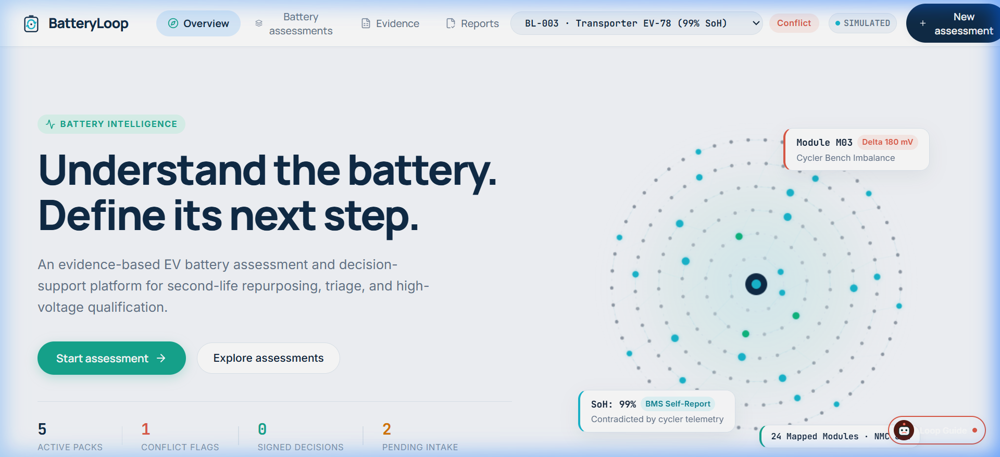
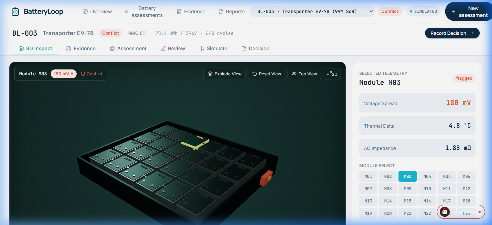
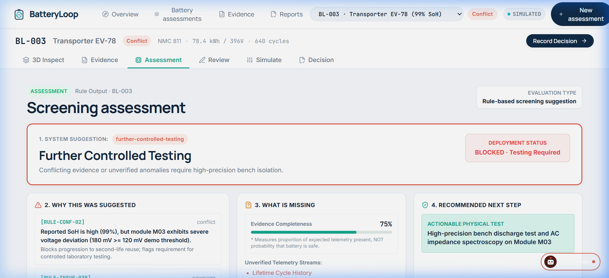
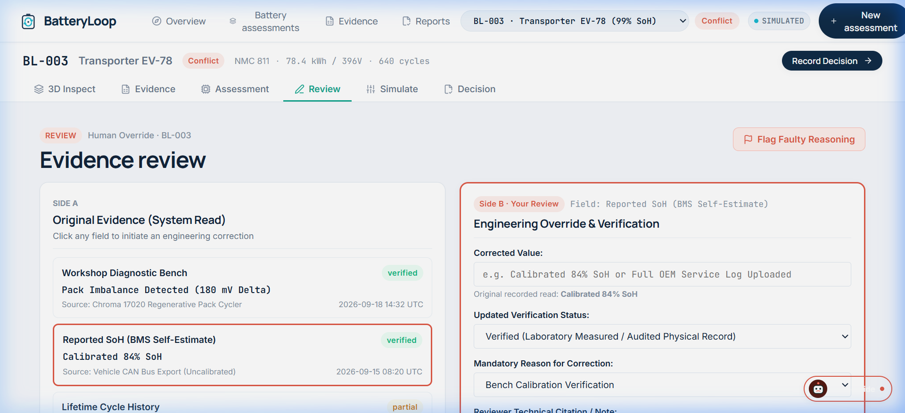
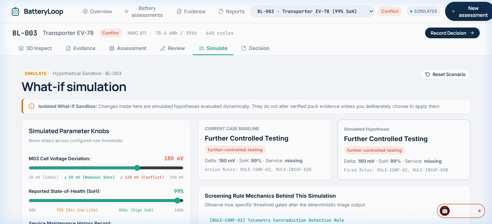

# BatteryLoop — Decision Theatre

> **Interactive 3D Battery Second-Life Decision Workspace**  
> Built with React 19, TypeScript, Three.js, React Three Fiber, Zustand, and Vitest.

BatteryLoop is an industrial engineering workspace designed to evaluate high-voltage electric vehicle and industrial battery packs for second-life stationary storage, module-level reconditioning, or material recycling. 

Rather than a static dashboard or black-box model, BatteryLoop connects an **interactive 3D procedural battery pack** to an **explainable rule engine**, a **human challenge & review layer**, a **live what-if simulator**, and a **tamper-evident audit timeline**.

---

## 📸 Interactive 6-Stage Workflow & Screenshots

The application guides battery assessors through six connected stages where changes to evidence propagate across the 3D model, rules engine, and audit log.

### 01 · Select — Battery Pack Records & 3D Centerpiece
Choose from five seeded pack scenarios. Default primary demo case **BL-003** presents a compelling contradiction: an onboard BMS reporting **99% State-of-Health (SoH)** despite missing service logs and unverified telemetry.



*Features: 24-module procedural 3D pack preview, pack telemetry dossier, explode view toggle, and multi-case switcher.*

---

### 02 · Inspect — Deep Telemetry & Provenance
Rotate and zoom the 3D pack to inspect individual module health. Selecting **Module M03** reveals a critical **180 mV cell voltage deviation**, elevated internal resistance, and conflicting diagnostic source logs.



*Features: Real-time OrbitControls, 24 clickable modules with hover lifts, M03 oxide coral conflict highlight, source pedigree, timestamps, and 2D schematic fallback.*

---

### 03 · Assess — Transparent Rule Engine Suggestions
The deterministic decision engine evaluates telemetry streams in order of priority (Safety Flags → Conflicting Evidence → Insufficient Evidence → Degradation Suitability). For **BL-003**, it fires **`RULE-CONF-02` (Telemetry Contradiction Detection Rule)** and recommends **Further Controlled Testing**.



*Features: Evidence Coverage percentage meter, triggered reason codes, missing fields checklist, active rule cards with condition triggers and impact statements.*

---

### 04 · Review — Human Correction & Governance Challenge
Demands human-in-the-loop oversight. Engineers can inspect the original system read side-by-side with reviewer overrides, correct values after lab testing, mark missing fields, and flag automated reasoning objections with formal citations.



*Features: Dual-column workbench (System Read vs Your Review), mandatory review justification reason, reasoning objection logging, and instant recalculation.*

---

### 05 · Simulate — Live What-If Scenario Sandbox
An isolated hypothesis sandbox allowing assessors to test boundary conditions without altering verified pack evidence. Adjusting the **Module M03 voltage deviation slider below 50 mV** causes the rule engine to transition the recommendation from *Further Controlled Testing* to *Second-Life Evaluation Candidate*.



*Features: Interactive sliders (cell deviation, SoH, service record status, critical safety flags), live before/after cards, rule difference explanations, and option to commit simulated values.*

---

### 06 · Decide — Human Action Sign-off & Audit Dossier
Establishes clear governance separation across three columns:
1. **System Suggestion**: The software's rule-based recommendation.
2. **Human Decision**: The assessor's signed next workflow action with technical justification.
3. **Outstanding Requirements**: Physical testing and insulation standards that remain mandatory before pack deployment.

All interactions, telemetry challenges, and decisions are permanently chronicled in the **Decision & Audit Timeline** and can be exported as a JSON dossier or printed.

---

## ⚡ Core Architecture & Technology Stack

| Layer | Technologies | Purpose |
| :--- | :--- | :--- |
| **Frontend Framework** | React 19 + TypeScript + Vite | Type-safe, fast HMR web application |
| **3D Graphics** | Three.js + React Three Fiber + Drei | Procedural 3D battery tray, busbars, and 24 interactive module meshes |
| **State Management** | Zustand + LocalStorage | Synchronizes battery state, reviewer edits, and audit logs across stages |
| **Icons & Micro-UI** | Lucide React | Clean industrial iconography |
| **Typography** | Manrope · Inter · JetBrains Mono | Scientific editorial typography (Google Fonts) |
| **Testing** | Vitest + React Testing Library | Automated rule engine unit tests |

### Scientific Editorial Tokens & Light Theme Palette
- **Canvas Background (`#F6F8FC`)**: Spacious, clean application canvas
- **Primary Surface (`#FFFFFF`)**: Pure white cards and elevation surfaces
- **Secondary Surface (`#F0F5FA`)**: Soft technical backdrop
- **Deep Navy (`#102B46` / `#12243A`)**: Editorial headlines and primary text
- **Teal Accent (`#16A890`)**: Primary actions, brand energy, and validated status
- **Scientific Cyan (`#19B9D0`)**: Active visual highlights and constellation nodes
- **Review Coral (`#E05A47`)**: Human overrides, telemetry conflict warnings
- **Status Amber (`#D97706`)**: Incomplete evidence, pending test gates
- **Risk Red (`#EF4444`)**: Critical safety flags, deployment blockers

---

## 🧪 Deterministic Rule Engine (`evaluateBattery.ts`)

The recommendation engine is 100% deterministic, explainable, and test-covered without external API dependencies:

1. **`RULE-SAFE-01` — Critical Safety Gate**: Immediate halt on physical intrusion, venting alarms, or thermal runaway history → Routes to **Material Recycling**.
2. **`RULE-CONF-02` — Telemetry Contradiction**: High reported SoH (≥ 85%) contradicted by severe module voltage imbalance (≥ 120 mV) → Recommends **Further Controlled Testing**.
3. **`RULE-INSUF-03` — Evidence Completeness Gate**: Evidence coverage < 50% or ≥ 3 missing telemetry streams → Recommends **Further Controlled Testing**.
4. **`RULE-REPAIR-04` — Localized Repair Screening**: Single module variance (50–120 mV) with sound overall pack integrity → Recommends **Module Repair / Reconditioning**.
5. **`RULE-SUIT-05` — Second-Life Suitability**: SoH ≥ 75%, cell delta ≤ 50 mV, and evidence coverage ≥ 70% → Recommends **Second-Life Stationary Storage Candidate**.
6. **`RULE-RECYC-06` — Capacity Exhaustion**: SoH < 70% or widespread cell degradation → Recommends **Material Recycling**.

---

## 🚀 Getting Started

### Prerequisites
- Node.js (v18 or higher recommended)
- npm or yarn

### Installation & Run

```bash
# Clone the repository
git clone https://github.com/bhargava562/battery-loop-demo.git
cd battery-loop-demo

# Install dependencies
npm install

# Start development server
npm run dev
```

Open [http://localhost:5173/](http://localhost:5173/) in your browser.

### Run Unit Tests

```bash
# Execute Vitest rule engine test suite
npm run test
```

### Production Build

```bash
# Compile TypeScript and bundle production assets
npm run build
```

---

## 📋 3-Minute Live Demonstration Flow

1. **0:00–0:30 · The Contradiction**: Select `BL-003`, rotate the 3D pack, click Module `M03`, and highlight the 99% reported SoH alongside the 180 mV cell voltage deviation.
2. **0:30–1:00 · The Suggestion**: View Stage 03 to show *Further Controlled Testing*, the triggered rule `RULE-CONF-02`, and the contextual advice from the Loop Field Guide.
3. **1:00–1:45 · Human Review**: Navigate to Stage 04, record a bench test correction or flag automated reasoning, and observe the immediate rule recalculation.
4. **1:45–2:20 · Live What-If**: In Stage 05, slide Module M03's voltage deviation down to 25 mV and watch the outcome shift to *Second-Life Evaluation Candidate*.
5. **2:20–3:00 · The Human Decision**: In Stage 06, record the human decision, sign off with technical justification, and export the tamper-evident JSON audit dossier.

---

## ⚖️ Disclaimer

The thresholds (e.g., 50 mV nominal limit, 120 mV contradiction gate) and evidence coverage scores used in this application are illustrative engineering screening assumptions configured for this decision-support demonstration. They do not constitute formal battery safety certifications or regulatory compliance approvals.
